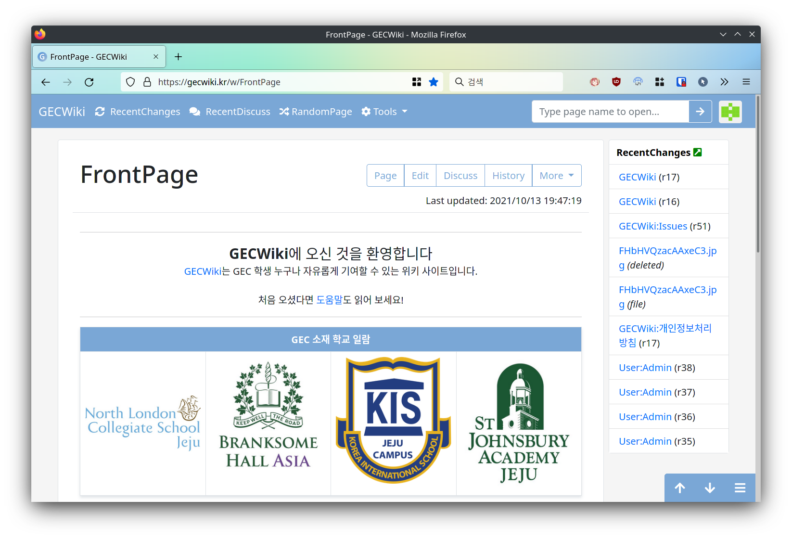

# AkariEngine
[](https://deepscan.io/dashboard#view=project&tid=16356&pid=19628&bid=512678)

AkariEngine is a Node.js based wiki engine, built with customizability in mind. Expect blazing fast rendering, customizable skins, flexible deployment and more.

## Key Features
* Simple and powerful markup (grammar) with features such as tables, videos and maps
* Blazing fast wikitext rendering using [Chevrotain](https://chevrotain.io/docs/)
* To-the-point, no hassle configuration with a single .json file
* Real time, thread-like discussion with Socket.IO
* Flexible database choice supporting MySQL/MariaDB and SQLite
* Built in permission/ACL management
* Per-user Vue skin system to customize look
* Full text search via Meilisearch
* Available scalability with Redis caching
* Server side extension system for routes, models and custom rendering behavior

### Use cases
* [GECWiki](https://gecwiki.kr) (website retired)

## Quick start
**Disclaimer**: Note that this is for testing puposes only. For more information on how to deploy, please refer to the wiki's [installation page](https://github.com/kbmin24/AkariEngine/wiki/Installation).

1. Make sure Node.js v24 is installed, then install Sqlite:
```bash
$ sudo apt install sqlite3
```
**Note**: You may install mariadb instead. For advanced setup, please look at [our wiki](https://github.com/kbmin24/AkariEngine/wiki/Installation)

2. Clone the repository:
```bash
$ git clone https://github.com/kbmin24/AkariEngine.git
```
3. Install all dependencies:
```bash
$ npm i
$ cd frontend && npm i
```
4. Create your local configuration:
```bash
$ cd ..
$ cp LocalSettings_Example.json LocalSettings.json
```
Update `LocalSettings.json` for your environment. Review the database configuration, application port, session secret, and any optional integrations before starting. You may want to look [here](https://github.com/kbmin24/AkariEngine/wiki/LocalSettings) for more info.

5. Start the backend:
```bash
$ npm start
```

6. In a separate terminal, start the frontend:
```bash
$ cd frontend
$ npm run dev
```

## Directory Structure
```
server.js                 Backend bootstrap
src/
  config/                 Application and database configuration
  routes/                 API routes and middleware chains
  controllers/            HTTP request and response adapters
  services/               Business rules and authorization
  repositories/           Database and search access
  models/                 Sequelize model factories
  middlewares/            Authentication, validation, CSRF, uploads, errors
  socket/                 Real-time event handlers
  utils/wikimark/          Wikitext lexer, parser, and render visitors
frontend/
  app/                    Pages, components, composables, stores, and assets
  server/                 Nuxt server routes
skins/                    Custom Vue layouts
extensions/               Optional backend extensions
locales/                  Shared translation catalogs
public/                   Static assets and vendored browser libraries
uploads/                  Uploaded files

```

## Licence
AkariEngine is distributed under GNU AGPL 3.0.
